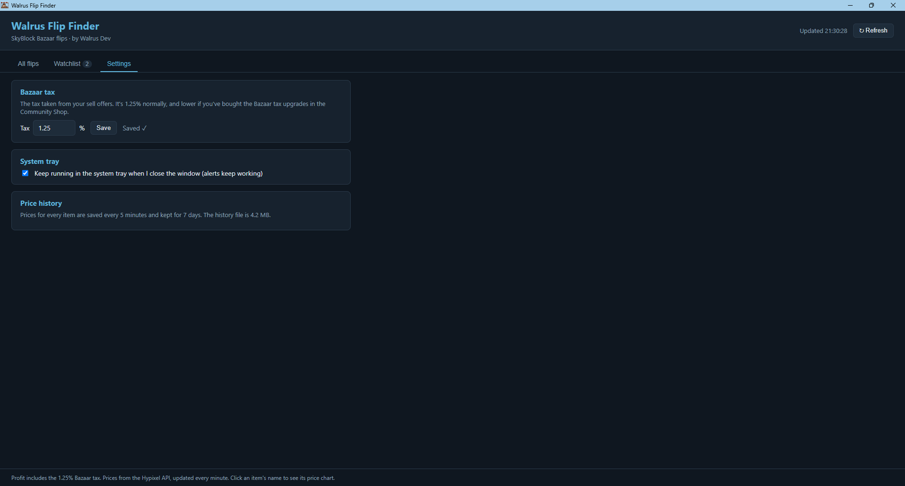

# Walrus Flip Finder

A Windows desktop app that finds the most profitable **Hypixel SkyBlock Bazaar flips** in real time. It pulls live prices for every Bazaar item, works out the profit after tax, and keeps a week of price history so you can see where a price is heading before you trade.

Built with Python and pywebview, so the backend is Python and the interface is HTML, CSS and JavaScript.



---

## Features

- **Live flip table:** every Bazaar item with buy price, sell price, profit per item, margin and weekly volume. Refreshes every minute.
- **Sorting, search and filters:** sort by any column, search by name, and filter out low-volume or low-profit items.
- **"Best flip" banner:** highlights the trade with the best balance of profit and how often it actually sells.
- **Price charts:** click any item to see its buy and sell price over the last 24 hours or 7 days, with the current, lowest and highest price and the change.
- **Watchlist with price alerts:** star an item, set a target such as `250k` or `1.5m`, and get a Windows notification when the price goes above or below it.
- **Price history:** prices are saved locally in SQLite every 5 minutes and kept for 7 days.
- **System tray:** close the window and the app keeps running in the tray, so alerts keep working.
- **Custom tax:** set your own Bazaar tax if you've bought the tax upgrades in the Community Shop.

## How it works

| Part | What it does |
|---|---|
| **Prices** | Hypixel's public Bazaar API (`api.hypixel.net/v2/skyblock/bazaar`). It needs no API key and returns every item in one request. |
| **Profit** | `sell × (1 − tax) − buy`. The tax defaults to 1.25%. |
| **Weekly volume** | The smaller of the buy and sell weekly volumes, because a flip is only as fast as its slower side. |
| **Best flip** | Profit × weekly volume × 1%. This rewards trades that are both profitable and actually move. |
| **Background thread** | Fetches prices every 60 seconds without freezing the window. A `threading.Lock` protects the shared data. |
| **Python ↔ JavaScript** | pywebview exposes a Python `Api` class to the page as `window.pywebview.api`. |
| **History** | An SQLite database in WAL mode. The background thread has its own connection, because SQLite connections can't be shared between threads. The 7-day view is averaged into 30-minute buckets. |

## Tech stack

- **Python:** pywebview, sqlite3, threading, urllib
- **Front end:** HTML, CSS, JavaScript, Chart.js
- **Windows extras:** winotify (notifications), pystray + Pillow (tray icon)
- **Packaging:** PyInstaller

## Getting started

You need **Windows** and **Python 3.10+**.

```bash
git clone https://github.com/marcus2045/Walrus-Flip-Finder.git
cd Walrus-Flip-Finder
pip install -r requirements.txt
python app.py
```

`winotify`, `pystray` and `pillow` are optional. Without them the app still runs, but you only get in-app alerts and no tray icon.

> Price charts load Chart.js from a CDN, so the charts need an internet connection. The prices need one too.

## Building the .exe

```bash
pip install pyinstaller
pyinstaller "Walrus Flip Finder.spec"
```

The finished app is saved to `dist/Walrus Flip Finder.exe`.

## Where your data is saved

Everything is stored locally in `%APPDATA%\WalrusFlipFinder\`:

| File | Contents |
|---|---|
| `watchlist.json` | Your watched items and alert targets |
| `settings.json` | Tax and tray settings |
| `history.db` | 7 days of price history |

Nothing is sent anywhere except the request to Hypixel's public API.

## Project structure

```
Walrus-Flip-Finder/
├── app.py                    # Python backend: prices, profit maths, alerts, history, tray
├── web/
│   ├── index.html            # Layout: All flips, Watchlist and Settings tabs, chart pop-up
│   ├── style.css             # Dark Walrus Dev theme
│   └── app.js                # Tables, sorting, filters, watchlist, charts, settings
├── icon.ico
├── Walrus Flip Finder.spec   # PyInstaller build settings
└── requirements.txt
```

## What I learned

- Running network requests on a background thread while keeping the GUI responsive, and protecting shared data with a lock
- Designing an SQLite table for time-series data (composite primary key, `WITHOUT ROWID`, WAL mode) and cleaning out old rows
- Why SQLite connections can't cross threads, and how to structure code around that
- Connecting a Python backend to a JavaScript front end with pywebview
- Packaging a multi-file app into a single `.exe` with PyInstaller

## Roadmap

- [ ] Bundle Chart.js locally so the charts work without the CDN
- [ ] Small 24-hour sparkline next to each item in the watchlist

## Version history

- **v1.2:** SQLite price history, price charts (24 h / 7 d), system tray, Settings tab with custom tax
- **v1.1:** Watchlist, price alerts (Windows notifications and in-app), background price thread
- **v1.0:** Flip table, sorting, search, filters, favourites, best flip banner

---

Made by **Marcus Rowan** (Walrus Dev) · [Portfolio](https://marcus2045.github.io) · [GitHub](https://github.com/marcus2045)

*Not affiliated with Hypixel. Uses Hypixel's public API.*
